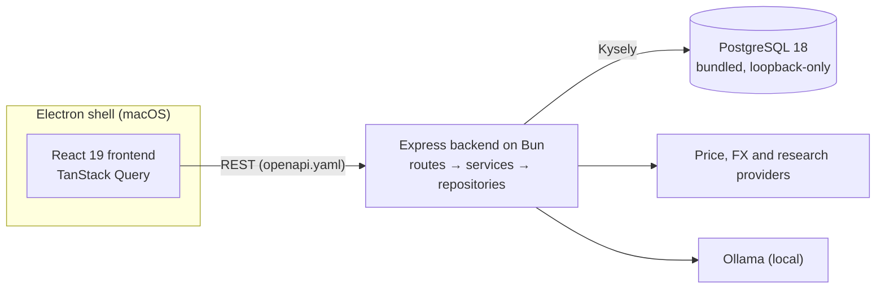

# Vision

<p align="center">
  <strong>Self-hosted personal finance for people who care about privacy, clarity, and control.</strong><br/>
  Track transactions, plan cash flow, manage investments, and prepare your Belgian taxes, all on your own Mac.
</p>

<p align="center">
  <a href="https://github.com/EraPartner/Vision/actions/workflows/ci.yml"></a>
  <a href="LICENSE"></a>
  
  
  
  
  
</p>

---

## What is Vision?

Vision is a desktop finance manager. It imports your bank exports, categorizes and analyses your
spending, tracks your portfolio and net worth, and computes Belgian personal income tax. The
macOS app bundles its own PostgreSQL 18 database, so your data lives in a private, loopback-only
database on your Mac.

- **Private by default.** No account and no cloud service. AI chat and investigations run on a
  local Ollama model ([AI data access](docs/security/ai-data-access.md)).
- **One app.** Transactions, budgets, planned payments, forecasts, investments, research, and tax
  in one place.
- **Built to last.** A strict TypeScript monorepo with an OpenAPI contract, a PostgreSQL schema
  under versioned migrations, and tests against a real database.

Vision is a native macOS app for Apple Silicon. There are no Windows, Linux, or browser builds
([ADR-219](docs/adr/219-minimal-electron-shell-hardening.md)).

---

## Features

### 💳 Transactions and imports

- CSV import from **Belfius, Revolut, KBC, SABB, Wise, ING, BNP Paribas Fortis**, a Vision
  backup, or a **generic CSV mapper**
- Deduplication, categorization rules, transfer detection between your own accounts, splits,
  tags, attachments, and bulk actions across many rows at once
- Accounts with running balances and reconciliation
- Export to CSV or the Vision backup format

### 📅 Budgeting and planning

- Categories and recipients with rules, merging, and exclusions
- Planned and recurring transactions with execution history
- Cash-flow forecast from planned transactions or statistical methods, with confidence bands
- Statistics: year-over-year comparisons, pivot tables with drill-through, a Sankey flow chart,
  rolling averages, and saved custom charts
- Analysis workspace over approved datasets, with saved analyses and scheduled monitors

### 📈 Portfolio and net worth

- Stocks, ETFs, crypto, precious metals, real estate, savings, and bonds
- Price providers: **Yahoo Finance**, **Binance**, **Kinesis**, and **custom JSON endpoints**
- Currency conversion from stored rates (ECB, with open.er-api for currencies ECB does not publish)
- Daily net-worth snapshots and performance over time
- Portfolio statement import, market lookup, watchlist, and research dossiers

### 🇧🇪 Belgian tax

- Personal income tax calculator with regional rules, deductions, and cadastral income
- Portfolio tax tracking (including the Reynders rule)
- The server computes all tax figures ([ADR-217](docs/adr/217-belgian-tax-figures-on-the-server.md))

### 🤖 AI chat

- Local assistant on **Ollama** that answers questions about your transactions and categories
  with tool-backed result cards

### 🧩 App

- English and Dutch
- PDF reports for finances, portfolio, and tax
- Backup and restore, with optional AES-256-GCM encryption (per-backup random salt)
- In-app updates for the packaged app, with a backup and rollback path

Feature details live in [`docs/features/`](docs/features/index.md).

---

## Quick start

### Install the macOS app

Install the release DMG. It contains PostgreSQL 18, the migrations, the backend and the frontend.
PDF reports print with the desktop app's own Electron Chromium. You do not need a separate
PostgreSQL service.

Vision creates its database under its macOS application-data directory on first launch. See
[`docs/guides/native-macos-runtime.md`](docs/guides/native-macos-runtime.md) for data migration
and rollback.

### Build the app from source

You need Bun, Node.js, and a PostgreSQL 18.6 distribution from Postgres.app or Homebrew
(`postgresql@18`). The PostgreSQL service does not need to run.

```bash
git clone https://github.com/EraPartner/Vision.git
cd Vision
./install.sh
open /Applications/Vision.app
```

### Try the demo

**Vision Demo** is a separate app with deterministic synthetic data. It uses its own database
below `~/Library/Application Support/Vision Demo/native/vision_demo` and cannot reach the real
Vision database.

```bash
./install-demo.sh
open "/Applications/Vision Demo.app"
bun run demo:reset-native   # restore the canonical dataset, then reopen the Demo app
```

Both installers build the frontend in a private temporary directory and do not touch the
repository's `dist` directory.

### Development mode

```bash
bun install
bun run native:prepare   # one-time: private PostgreSQL payload
bun run dev              # private PostgreSQL + watched backend + Vite
```

| Service     | URL                                                    |
| ----------- | ------------------------------------------------------ |
| Frontend    | `http://localhost:8080` (picks the next port if taken) |
| Backend API | `http://localhost:3002`                                |

More setup detail: [`docs/getting-started.md`](docs/getting-started.md).

---

## Architecture



- **The server computes, the browser displays.** Totals, FX conversion, gains, forecasts, and tax
  are computed by the backend ([ADR-216](docs/adr/216-server-owned-domain-calculations.md)).
- **Database access** goes through Kysely with types generated from the migrated schema
  ([ADR-226](docs/adr/226-kysely-query-builder.md)).
- **Migrations** are numbered `.sql` files in `db/migrations/`, applied by a Kysely migrator on
  boot, starting from one baseline ([ADR-222](docs/adr/222-typescript-migrations-kysely-baseline.md)).
- **Ids, currency codes and money are branded types**
  ([ADR-220](docs/adr/220-branded-ids-currency-codes-and-money.md)).

Read more in [`docs/architecture/`](docs/architecture/index.md) and the
[ADRs](docs/adr/).

### Monorepo layout

```text
Vision/
├── apps/
│   ├── frontend/          # React 19 + TypeScript + Vite (features/, components/, hooks/, stores/)
│   └── node-backend/      # Express API on Bun (routes/, services/, repositories/, integrations/)
├── packages/
│   ├── shared-utils/      # Pure helpers shared by backend and frontend (money, CSV, Belgian tax engine)
│   └── types/             # Shared TypeScript types and branded ids
├── packaging/electron/    # Desktop shell and native PostgreSQL runtime
├── db/migrations/         # PostgreSQL migrations (Kysely migrator)
├── i18n/source/           # Locale sources, compiled to apps/frontend/src/locales/
├── scripts/               # Repository tooling (locales, checks, test database)
├── config/                # Shared tool configuration
├── docs/                  # Obsidian knowledge base (ADRs, features, guides, reference)
└── openapi.yaml           # REST API contract
```

### Tech stack

| Layer    | Technology                                                                    |
| -------- | ----------------------------------------------------------------------------- |
| Frontend | React 19, TypeScript, Vite, Tailwind CSS, Radix UI, shadcn/ui, TanStack Query |
| Backend  | Express on Bun, Zod, decimal.js                                               |
| Database | PostgreSQL 18.6 with Kysely                                                   |
| Desktop  | Electron, Apple Silicon DMG and ZIP                                           |
| AI       | Ollama (local)                                                                |
| Testing  | Vitest, with backend tests against a disposable PostgreSQL 18                 |
| API spec | OpenAPI 3 (`openapi.yaml`)                                                    |

---

## Development

### Common scripts

```bash
# Run
bun run dev                  # private PostgreSQL + watched backend + Vite
bun run electron:dev         # desktop shell with isolated development data

# Check
bun run lint                 # frontend ESLint + import boundaries (depcruise) + dead code (knip)
bun run lint:backend         # backend ESLint
bun run typecheck            # frontend; typecheck:backend, typecheck:packages, typecheck:electron for the rest
bun run check                # every lint, typecheck and test gate in sequence

# Test
bun run test                 # backend Vitest suite
bun run test:db              # backend suite with a private temporary PostgreSQL 18
bun run test:frontend        # frontend suite with a disposable PostgreSQL 18 and live API contracts
bun run test:all             # backend + frontend suites

# Database
bun run db:migrate           # apply pending migrations
bun run db:status            # list applied and pending migrations
bun run db:new -- <name>     # create db/migrations/NNNN_<name>.sql
bun run db:lint              # squawk lint of migration SQL
bun run db:codegen           # regenerate the Kysely database types

# API and locales
bun run generate:types       # regenerate apps/frontend/src/types/generated.ts from openapi.yaml
bun run check-endpoint-matrix # check docs/reference/api-endpoint-matrix.md against openapi.yaml
bun run validate-locales     # check en/nl key parity

# Package
bun run dist                 # build and package the Electron app
```

The full list, with what each script needs, is in
[`docs/reference/scripts.md`](docs/reference/scripts.md).

### Configuration

The packaged app generates its own database credentials and writes them to a restricted
`runtime.env` in its application-data directory. Do not set a database URL for it.

For source development, copy `.env.example` to `.env` only when you need provider API keys or
overrides. The template documents every optional setting (database roles, logging, Ollama,
AI web research, research providers). See
[`docs/reference/environment-variables.md`](docs/reference/environment-variables.md).

### Contributing

1. Create a branch from `main`.
2. Write tests at stable boundaries: API contracts, real PostgreSQL state, and pure domain
   functions ([ADR-215](docs/adr/215-behaviour-boundary-tests.md)).
3. Run `bun run lint`, `bun run lint:backend`, `bun run typecheck`, and the relevant tests.
4. Use Conventional Commits. `main` requires signed commits, linear history, and a passing
   `CI Complete` check.
5. When you change an endpoint, update `openapi.yaml`, regenerate types, and update the endpoint
   matrix. When you change behaviour, update `docs/`.

See [`docs/guides/contributing.md`](docs/guides/contributing.md) and
[`docs/guides/cicd-pipelines.md`](docs/guides/cicd-pipelines.md).

### Coding agents

[`AGENTS.md`](AGENTS.md) is the shared guide for coding agents. Claude Code also gets edit-time
checks, a read-only PostgreSQL MCP server, a TypeScript navigation MCP server, and structural
search with `bun run search:ast`
([ADR-227](docs/adr/227-claude-code-static-analysis-aids.md),
[ADR-228](docs/adr/228-typescript-navigation-mcp.md)).

---

## Releases

Pushing a `vX.Y.Z` tag runs [`release.yml`](.github/workflows/release.yml), which builds the Apple
Silicon app and DMG and publishes a GitHub Release. It does not re-run the test suites: the tagged
commit must be on `main` with a passing `CI Complete` check. It re-runs the secrets scan and
dependency audits on the release tree before packaging.

---

## Security and privacy

- Your data stays in a loopback-only PostgreSQL database on your Mac.
- Never commit real `.env` files or secrets.
- The Electron shell runs with context isolation and the sandbox on, and Node integration off.
- Backups can be encrypted with AES-256-GCM (per-backup random salt).
- Ollama runs locally by default. If you point it at a remote endpoint, that endpoint receives
  your prompts and tool results.

See [`docs/security/`](docs/security/).

---

## License

Licensed under **AGPL-3.0-only**. See [LICENSE](LICENSE).
